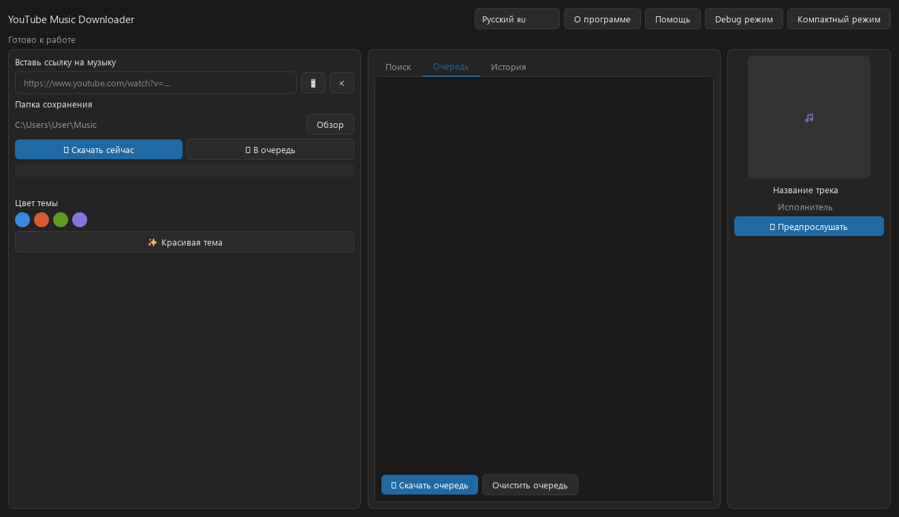

# YouTube Music Downloader

[Українська](README.md) | [English](README.en.md) | [Русский](README.ru.md)

A desktop app for finding and downloading music from YouTube and YouTube Music. Its interface is built with PyQt6. It uses `yt-dlp` to retrieve audio and `FFmpeg` to convert it to MP3.

## Interface



## Features

- Search for tracks on YouTube and YouTube Music.
- Retrieve a track's title, artist, and cover art from a link.
- Preview tracks before downloading.
- Download a single track or a queue as MP3 at the highest available source audio quality.
- Add metadata and cover art to MP3 files.
- Choose the download folder, interface language (Ukrainian, English, or Russian), theme, and accent color.
- Browse download history and in-app help.
- Automatically install and update `yt-dlp` and `FFmpeg`.

## Run from source

Windows and Python 3 are required. The app downloads `yt-dlp` and `FFmpeg` on first launch and updates them automatically afterward.

```powershell
python -m venv .venv
.\.venv\Scripts\Activate.ps1
python -m pip install -r requirements.txt
python main.py
```

If PowerShell does not allow virtual environment activation, install the dependencies without activating it:

```powershell
python -m pip install -r requirements.txt
python main.py
```

## Build the app

Building the installer requires Python, Inno Setup 6, and the project dependencies. From the repository root, run:

```powershell
.\.venv\Scripts\Activate.ps1
.\build.bat
```

The script builds the app with PyInstaller and, if Inno Setup 6 is installed, creates an installer in `dist\installer\`. If Inno Setup is not found, install it and run `build.bat` again.

## App data

Settings, download history, and downloaded tools are stored separately from the app:

```text
%LOCALAPPDATA%\YouTubeMusicDownloader\
```

When uninstalling, the installer also asks whether to remove this data. Downloaded music is not affected.

## Project structure

- `main.py` — app entry point.
- `app/` — interface, downloader, settings, help, themes, and translations.
- `requirements.txt` — Python dependencies.
- `build.bat`, `YouTubeMusicDownloader.spec`, `installer.iss` — app and installer build files.

## Tools and libraries

- [yt-dlp](https://github.com/yt-dlp/yt-dlp)
- [FFmpeg](https://ffmpeg.org/)
- PyQt6, Pillow, and Mutagen
